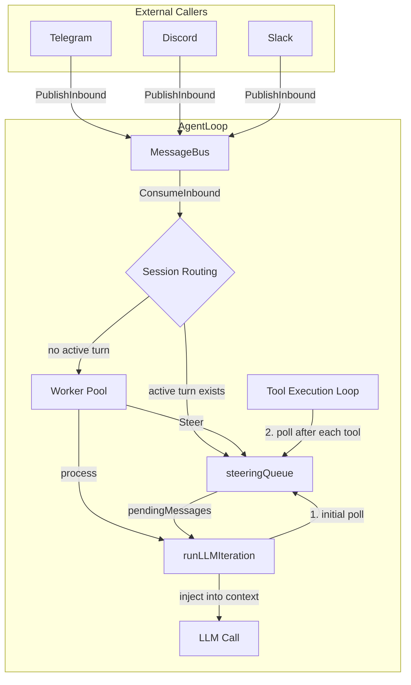
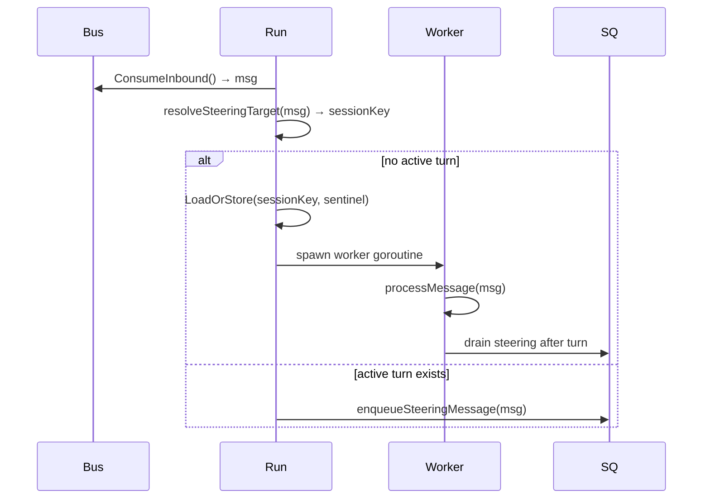
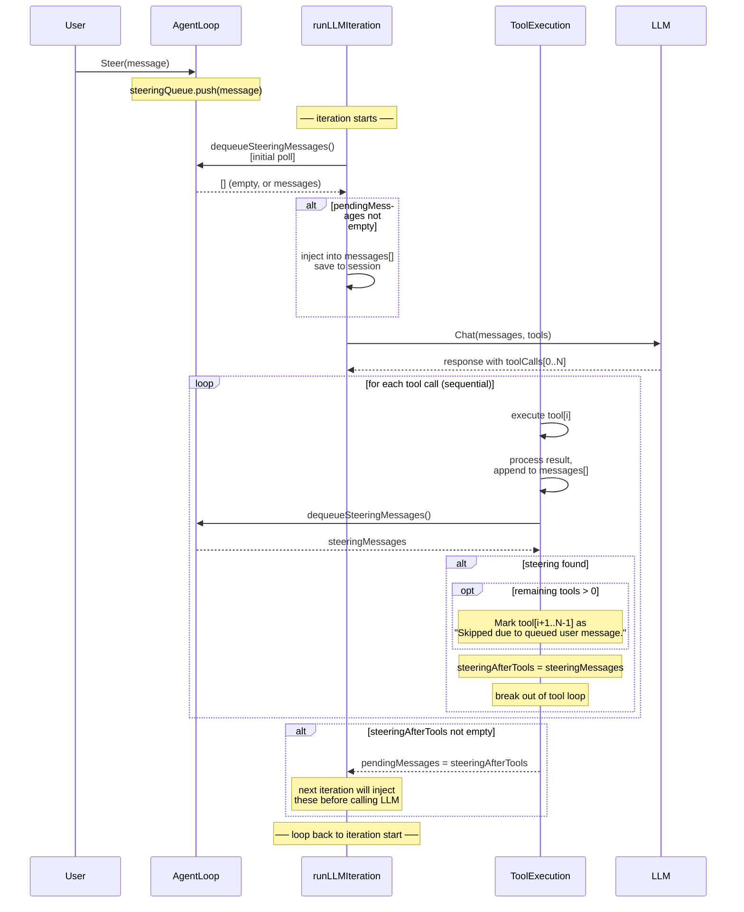
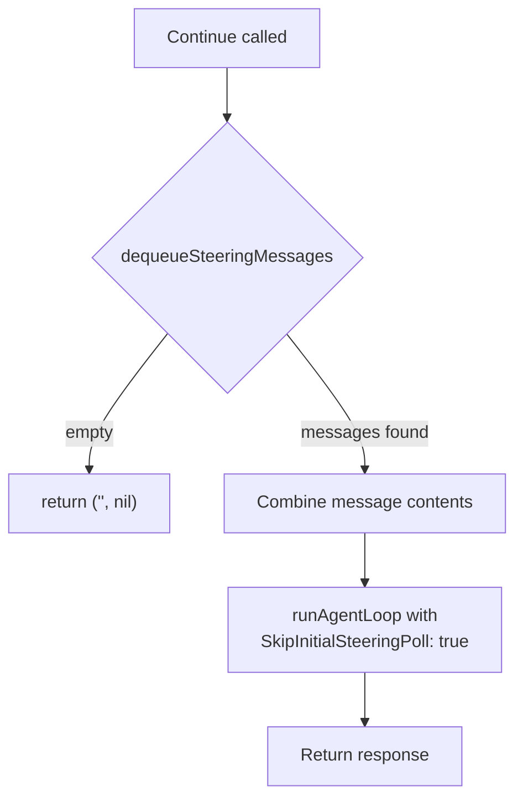

# Steering — 实现规范

## 问题

当 agent 正在运行（执行一串工具调用）时，用户无法让它改变方向。用户必须等待整个周期完成后才能发送新消息。当 agent 走错方向时，这会造成很差的体验——用户只能看着它把时间浪费在已经不再相关的工具上。

## 解决方案

Steering 引入一个**消息队列**，外部调用方可以在任何时候向其中推入消息。agent loop 在明确定义的检查点轮询这个队列。当发现 steering 消息时，agent 会：

1. 停止执行当前批次中后续的工具
2. 将用户消息注入会话上下文
3. 使用更新后的上下文再次调用 LLM

用户的意图会**在当前工具一完成时**就到达模型，而不是等整个 turn 完成之后。

## 架构概览



### 消息路由与 worker pool

渠道（Telegram、Discord 等）通过 `PublishInbound` 将消息发布到 `MessageBus`。`Run()` 循环从 bus 消费消息，并根据每条消息的 **session key** 进行路由：

- **该会话没有活动 turn**：通过 `LoadOrStore(sessionKey, struct{}{})` 原子地预留 session key，并启动一个 **worker goroutine** 来处理完整的 turn 生命周期。
- **该会话存在活动 turn**：消息通过 `enqueueSteeringMessage` 直接进入 steering 队列。它会被现有 worker 的 steering drain 循环取走。
- **不可路由（system）**：在主循环中同步处理。

这使得**来自不同会话的消息可以并行处理**（最多 `max_parallel_turns` 个），同时同一会话的消息保持严格串行。



## 数据结构

### steeringQueue

一个线程安全的 FIFO 队列，私有于 `agent` 包。

| 字段 | 类型 | 说明 |
|-------|------|-------------|
| `mu` | `sync.Mutex` | 保护对 `queue` 和 `mode` 的所有访问 |
| `queue` | `[]providers.Message` | 待处理的 steering 消息 |
| `mode` | `SteeringMode` | 出队策略 |

**方法：**

| 方法 | 说明 |
|--------|-------------|
| `push(msg) error` | 向队列追加一条消息。队列已满（`MaxQueueSize`）时返回错误 |
| `dequeue() []Message` | 按照 `mode` 移除并返回消息。为空时返回 `nil` |
| `len() int` | 返回当前队列长度 |
| `setMode(mode)` | 更新出队策略 |
| `getMode() SteeringMode` | 返回当前模式 |

### SteeringMode

| 值 | 常量 | 行为 |
|-------|----------|----------|
| `"one-at-a-time"` | `SteeringOneAtATime` | `dequeue()` 只返回**第一条**消息。剩余消息留在队列中供后续轮询使用。 |
| `"all"` | `SteeringAll` | `dequeue()` 清空**整个**队列并一次性返回所有消息。 |

默认值：`"one-at-a-time"`。

### processOptions 扩展

为 `processOptions` 新增了一个字段：

| 字段 | 类型 | 说明 |
|-------|------|-------------|
| `SkipInitialSteeringPoll` | `bool` | 为 `true` 时，跳过 loop 开始时的一次 steering 轮询。由 `Continue()` 使用，以避免重复出队。 |

## AgentLoop 上的公共 API

| 方法 | 签名 | 说明 |
|--------|-----------|-------------|
| `Steer` | `Steer(msg providers.Message) error` | 将一条 steering 消息入队。队列已满或未初始化时返回错误。线程安全，可从任意 goroutine 调用。 |
| `SteeringMode` | `SteeringMode() SteeringMode` | 返回当前出队模式。 |
| `SetSteeringMode` | `SetSteeringMode(mode SteeringMode)` | 在运行时修改出队模式。 |
| `Continue` | `Continue(ctx, sessionKey, channel, chatID) (string, error)` | 使用给定会话中待处理的 steering 消息恢复空闲 agent。队列为空时返回 `""`。使用基于会话的活动 turn 检查（不会因无关会话而阻塞）。 |

## 集成到 Agent Loop

### steering 的接入位置

steering 队列作为 `AgentLoop` 上的一个字段存在：

```
AgentLoop
  ├── bus
  ├── cfg
  ├── registry
  ├── steering  *steeringQueue   ← new
  ├── ...
```

它由 `NewAgentLoop` 根据 `cfg.Agents.Defaults.SteeringMode` 初始化。

### 通过 runLLMIteration 的详细流程



### 轮询检查点

| # | 位置 | 时机 | 目的 |
|---|----------|------|---------|
| 1 | `runLLMIteration` 顶部、第一次 LLM 调用之前 | 在 loop 入口执行一次 | 捕获 agent 仍在设置上下文期间入队的消息 |
| 2 | 每个工具完成后（包括第一个和最后一个） | 每个工具结果处理后立即执行 | 尽可能早地中断批次——如果发现 steering 且还有剩余工具，它们都会跳过 |

### 被跳过的工具会发生什么

当 steering 在工具 `[i]` 完成后中断一个工具批次时，从 `[i+1]` 到 `[N-1]` 的所有工具都**不会执行**。相反，会为每个工具生成一条 tool result 消息：

```json
{
  "role": "tool",
  "content": "Skipped due to queued user message.",
  "tool_call_id": "<original_call_id>"
}
```

这些结果会：
- 追加到会话 `messages[]`
- 通过 `AddFullMessage` 保存到会话

这确保 LLM 知道它请求的哪些操作没有执行。

### 循环条件变更

迭代循环条件从：

```go
for iteration < agent.MaxIterations
```

改为：

```go
for iteration < agent.MaxIterations || len(pendingMessages) > 0
```

这允许在 steering 恰好在最大迭代边界到达时**额外执行一次迭代**，确保 steering 消息总会被处理。

### 工具执行：并行 → 串行

**引入 steering 之前：** 一个批次中的所有工具调用都使用 `sync.WaitGroup` 并行执行。

**引入 steering 之后：** 工具调用**串行**执行。这是必需的，因为必须在各个工具完成之间轮询 steering。并行执行模型无法在批次中途进行中断。

> **权衡：** 当 LLM 在单个 turn 中请求多个独立工具时，这会引入延迟。在实践中，大多数批次包含 1-2 个工具，因此影响很小。能够中断带来的收益超过了这一成本。

### 为什么跳过剩余工具（而不是让它们完成）

当在批次中途检测到 steering 消息时，考虑过两种策略：

1. **跳过剩余工具**（已选择）——停止执行，将其余工具标记为已跳过，注入 steering
2. **完成所有工具，然后注入**——让所有工具运行，之后追加 steering

策略 2 因三个原因被拒绝：

**不可逆的副作用。** 工具可以发送邮件、写入文件、生成子代理或调用外部 API。如果用户说“停止”或“改变方向”，这些操作已经发生，无法撤销。

| 工具批次 | Steering | 跳过（1） | 完成（2） |
|---|---|---|---|
| `[search, send_email]` | "don't send it" | Email not sent | Email sent |
| `[query, write_file, spawn]` | "wrong database" | Only query runs | File + subagent wasted |
| `[fetch₁, fetch₂, fetch₃, write]` | topic change | 1 fetch | 3 fetches + write, all discarded |

**浪费的延迟。** 网络抓取和 API 调用等工具每次都需要数秒。在一个 3 工具批次中，如果每个工具平均耗时 3-4 秒，用户将需要等待 10 多秒，而工作随后会被丢弃。

**LLM 仍保有完整认知。** 被跳过的工具会收到明确的 `"Skipped due to queued user message."` 结果，因此模型知道自己没有完成什么，并可以决定是否使用新上下文重新执行，或采取不同路径。

## Continue() 方法

`Continue` 处理 agent 处于**空闲**状态（最后一条消息来自 assistant），而用户在此期间已经将 steering 消息入队的情况。



**为什么使用 `SkipInitialSteeringPoll: true`？** 因为 `Continue` 已经自行将消息出队。如果没有这个标志，`runLLMIteration` 会在开始时再次轮询并发现为空（队列已经为空），或者更糟，在此期间有新消息到达时会发生重复处理。

## 配置

```json
{
  "agents": {
    "defaults": {
      "steering_mode": "one-at-a-time",
      "max_parallel_turns": 1
    }
  }
}
```

| 字段 | 类型 | 默认值 | 环境变量 | 说明 |
|-------|------|---------|---------|-------------|
| `steering_mode` | `string` | `"one-at-a-time"` | `GOGOCLAW_AGENTS_DEFAULTS_STEERING_MODE` | 每次轮询时如何清空 steering 队列 |
| `max_parallel_turns` | `int` | `1` | `GOGOCLAW_AGENTS_DEFAULTS_MAX_PARALLEL_TURNS` | 最大并发 turn 数。`0` 或 `1` = 串行；`>1` = 跨会话并行 |


## 设计决策与权衡

| 决策 | 理由 |
|----------|-----------|
| 串行执行工具 | 每个工具后轮询 steering 所必需。并行执行无法在批次中途中断。 |
| 基于轮询（而非 channel/signal） | 保持实现简单。不需要 `select` 或 signal channel。轮询成本可忽略（mutex 加锁 + slice 长度检查）。 |
| 默认使用 `one-at-a-time` | 给模型分别响应每条 steering 消息的机会。行为比一次性倾倒所有消息更可预测。 |
| 被跳过的工具获得明确的错误结果 | LLM 协议要求 assistant 消息中的每个工具调用都有 tool result。省略它们会导致 API 错误。跳过消息还会告知模型哪些操作没有完成。 |
| `Continue()` 使用 `SkipInitialSteeringPoll` | 在恢复空闲 agent 时防止竞态条件和重复出队。 |
| 队列存储在 `AgentLoop` 上，而不是 `AgentInstance` 上 | steering 是 loop 层面的关注点（它影响迭代流程），不是每个 agent 的关注点。由于 `processMessage` 是串行的，所有 agent 共享该 steering 队列。 |
| 在 `Run()` 中进行 worker pool 调度 | 消息被调度到 worker pool，而不是单个串行循环。worker 启动前通过 `LoadOrStore` 原子预留 session key，从而防止 TOCTOU 竞态。同一会话的消息被串行化；不同会话并行处理（最多 `max_parallel_turns`）。 |
| 没有 bus drain goroutine | 旧的 `drainBusToSteering` goroutine 已被移除。主 `Run()` 循环现在针对每条入站消息检查 `activeTurnStates`：如果该会话有活动 turn，消息直接进入 steering 队列；否则启动新 worker。这消除了 drain 取消和重新入队的复杂性。 |
| 在 worker 中转录音频 | 音频在负责处理该 turn 的 worker 内转录，而不是在单独的 drain goroutine 中。 |
| `MaxQueueSize = 10` | 防止用户趁 agent 忙碌发送大量消息时造成无界内存增长。超出的消息会丢弃并记录警告。 |
