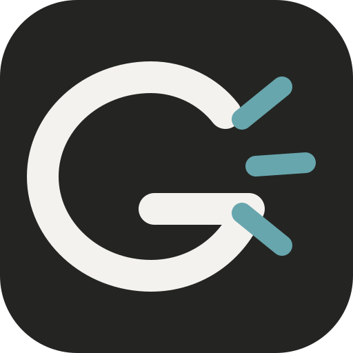

<div align="center">


<h1>GoGoClaw: 基于Go语言的超高效 AI 助手</h1>

<h3>容器优先的 Agent Harness · amd64 / arm64</h3>
  <p>
    
    
    
    <br>
    <a href="https://github.com/biaobiaobiao108/gogoclaw"></a>
    <a href="../README.md"></a>
  </p>

**中文** | [English](../../README.md)

</div>

---

**GoGoClaw** 是一个使用 **Go** 编写的轻量级 Agent Harness 与 Web 控制台，用于管理会话、模型、频道、工具、审批和运行时诊断。

⚡️ **容器优先**：生产镜像支持 64 位 x86 和 ARM Linux。原生二进制只用于开发与测试。

> [!CAUTION]
> **🚨 安全声明**
>
> - 生产部署仅支持容器镜像。
> - 容器即执行沙箱，因此工具审批默认关闭；需要人工复核时显式启用 `tools.approval`。
> - 将控制台暴露到公网前，请先阅读安全指南。

## ✨ 特性

🪶 **精简 Go 核心**: Agent 使用 Go 实现，自身不依赖 Node.js 或 Python 应用运行时；生产容量由容器宿主机提供。


🌍 **容器优先**: 生产镜像支持 x86-64 和 ARM64 Linux。

🔌 **MCP 支持**: 原生 [Model Context Protocol](https://modelcontextprotocol.io/) 集成 — 连接任意 MCP 服务器扩展 Agent 能力。

👁️ **视觉管线**: 直接向 Agent 发送图片和文件 — 自动 base64 编码对接多模态 LLM。

🧠 **智能路由**: 基于规则的模型路由 — 简单查询走轻量模型，节省 API 成本。

> 📋 **[硬件兼容列表](../guides/hardware-compatibility.zh.md)** — 查看可运行容器镜像的 Linux 主机。

### 🐜 容器宿主机

生产环境运行在支持 `amd64` 或 `arm64` 容器的 64 位 Linux 主机上。宿主机要求参见 [硬件兼容性列表](../guides/hardware-compatibility.zh.md)。

## 📦 生产部署（仅容器）

生产环境仅支持使用发布的 Linux 容器镜像。源码构建的原生二进制只用于开发和测试。

### 环境要求

- Docker Engine 和 Docker Compose v2
- 为 `/data` 使用持久化 Docker 卷
- 如果 Web 控制台或 Webhook 需要暴露到本机以外，使用带 TLS 的反向代理
- 能够访问模型 Provider 和聊天平台的外网

### 使用 Web 控制台启动

```bash
git clone https://github.com/biaobiaobiao108/gogoclaw.git
cd gogoclaw

docker compose -f docker/docker-compose.yml --profile launcher pull
docker compose -f docker/docker-compose.yml --profile launcher up -d
```

打开 `http://127.0.0.1:18800`，创建控制台密码，然后配置模型、Channel 和工具。首次使用时 launcher 会生成初始配置，并在同一容器内管理 gateway 进程。

launcher 端口默认只绑定回环地址。不要直接暴露到公网；如需远程访问，应放在经过加固的 TLS 反向代理之后：

```bash
# 仅在 TLS 反向代理或可信内网后方使用。
GOGOCLAW_LAUNCHER_BIND=0.0.0.0 \
  docker compose -f docker/docker-compose.yml --profile launcher up -d
```

### 无头 Gateway

先交互式生成初始配置：

```bash
docker compose -f docker/docker-compose.yml --profile gateway pull
docker compose -f docker/docker-compose.yml --profile gateway run --rm \
  --entrypoint gogoclaw gogoclaw-gateway onboard
```

再启动 gateway：

```bash
docker compose -f docker/docker-compose.yml --profile gateway up -d
```

需要接收 Webhook 的 Channel 使用 gateway 端口 `18790`。宿主机默认只绑定 `127.0.0.1`；只有反向代理或可信网络需要访问时才修改 `GOGOCLAW_GATEWAY_BIND`。

### 一次性 CLI 命令

```bash
# 单次提问
docker compose -f docker/docker-compose.yml --profile gateway run --rm \
  --entrypoint gogoclaw gogoclaw-gateway agent -m "2+2 等于多少？"

# 查看状态
docker compose -f docker/docker-compose.yml --profile gateway run --rm \
  --entrypoint gogoclaw gogoclaw-gateway status
```

### 数据、备份与更新

应用状态保存在命名卷 `gogoclaw-data` 中，并挂载到容器内 `/data`。其中包括 `/data/.gogoclaw/config.json`、凭据、工作区、会话和日志。

```bash
# 备份数据卷
docker run --rm \
  -v gogoclaw-data:/data:ro \
  -v "${PWD}:/backup" \
  alpine tar czf /backup/gogoclaw-data.tgz -C /data .

# 恢复到空数据卷（卷中不能已有状态）
docker run --rm \
  -v gogoclaw-data:/data \
  -v "${PWD}:/backup" \
  alpine tar xzf /backup/gogoclaw-data.tgz -C /data
```

更新时拉取新镜像并重建服务：

```bash
docker compose -f docker/docker-compose.yml --profile launcher pull
docker compose -f docker/docker-compose.yml --profile launcher up -d
```

项目不再提供应用内自更新。

### 容器安全边界

生产镜像使用 UID/GID `10001` 运行，以 `tini` 作为 PID 1；配套 Compose 配置启用：

- 只读根文件系统
- 删除全部 Linux capabilities
- `no-new-privileges`
- 有大小限制的可写 `/tmp`
- 默认仅绑定回环地址

工作区路径检查用于防止误写，不是操作系统级沙箱。生产安全边界是容器本身；不要把 Docker socket 或不必要的宿主机目录挂载进去。

### 开发构建

本地构建仅用于开发和测试。依赖：

- Go 1.27.3+
- Bun 1.4.4+
- Windows 上需要 PowerShell 7

```bash
make deps
make build
make build-launcher

# 完整 launcher 开发流程
cd web
make dev
```

Windows 上双击 `build\Start-GoGoClaw.cmd` 即可打开本机 Web 控制台。`build\gogoclaw.exe` 是命令行程序；不带命令直接双击时只会显示帮助并退出。

本地自动打开浏览器、`-public` 和直接运行 gateway 都是开发便利功能，不属于受支持的生产部署方式。

需要在本机测试容器构建时，使用开发覆盖文件：

```bash
docker compose -f docker/docker-compose.yml \
  -f docker/docker-compose.dev.yml --profile launcher up --build
```

## 🔌 Providers (LLM)

GoGoClaw 通过 `model_list` 配置支持 30+ LLM Provider，使用 `协议/模型` 格式：

| Provider | 协议 | API Key | 备注 |
|----------|------|---------|------|
| [OpenAI](https://platform.openai.com/api-keys) | `openai/` | 必填 | GPT-5.4、GPT-4o、o3 等 |
| [Anthropic](https://console.anthropic.com/settings/keys) | `anthropic/` | 必填 | Claude Opus 4.6、Sonnet 4.6 等 |
| [Google Gemini](https://aistudio.google.com/apikey) | `gemini/` | 必填 | Gemini 3 Flash、2.5 Pro 等 |
| [OpenRouter](https://openrouter.ai/keys) | `openrouter/` | 必填 | 200+ 模型，统一 API |
| [智谱 (GLM)](https://open.bigmodel.cn/usercenter/proj-mgmt/apikeys) | `zhipu/` | 必填 | GLM-4.7、GLM-5 等 |
| [DeepSeek](https://platform.deepseek.com/api_keys) | `deepseek/` | 必填 | DeepSeek-V3、DeepSeek-R1 |
| [火山引擎](https://console.volcengine.com) | `volcengine/` | 必填 | 豆包、Ark 系列模型 |
| [Qwen](https://dashscope.console.aliyun.com/apiKey) | `qwen/` | 必填 | Qwen3、Qwen-Max 等 |
| [Groq](https://console.groq.com/keys) | `groq/` | 必填 | 快速推理（Llama、Mixtral） |
| [Moonshot (Kimi)](https://platform.moonshot.cn/console/api-keys) | `moonshot/` | 必填 | Kimi 系列模型 |
| [Minimax](https://platform.minimaxi.com/user-center/basic-information/interface-key) | `minimax/` | 必填 | MiniMax 系列模型 |
| [Mistral](https://console.mistral.ai/api-keys) | `mistral/` | 必填 | Mistral Large、Codestral |
| [NVIDIA NIM](https://build.nvidia.com/) | `nvidia/` | 必填 | NVIDIA 托管模型 |
| [Cerebras](https://cloud.cerebras.ai/) | `cerebras/` | 必填 | 快速推理 |
| [Novita AI](https://novita.ai/) | `novita/` | 必填 | 多种开源模型 |
| [小米 MiMo](https://platform.xiaomimimo.com/) | `mimo/` | 必填 | MiMo 系列模型 |
| [Ollama](https://ollama.com/) | `ollama/` | 无需 | 本地模型，自托管 |
| [vLLM](https://docs.vllm.ai/) | `vllm/` | 无需 | 本地部署，兼容 OpenAI |
| [LiteLLM](https://docs.litellm.ai/) | `litellm/` | 视情况 | 100+ Provider 代理 |
| [Azure OpenAI](https://portal.azure.com/) | `azure/` | 必填 | 企业级 Azure 部署 |
| [GitHub Copilot](https://github.com/features/copilot) | `github-copilot/` | OAuth | 设备码登录 |
| [Antigravity](https://console.cloud.google.com/) | `antigravity/` | OAuth | Google Cloud AI |

<details>
<summary><b>本地部署（Ollama、vLLM 等）</b></summary>

**Ollama:**
```json
{
  "model_list": [
    {
      "model_name": "local-llama",
      "model": "ollama/llama3.1:8b",
      "api_base": "http://localhost:11434/v1"
    }
  ]
}
```

**vLLM:**
```json
{
  "model_list": [
    {
      "model_name": "local-vllm",
      "model": "vllm/your-model",
      "api_base": "http://localhost:8000/v1"
    }
  ]
}
```

完整 Provider 配置详情请参阅 [Providers & Models](../guides/providers.zh.md)。

</details>

## 💬 Channels（聊天应用）

通过内置 Web 控制台或受支持的消息平台与 GoGoClaw 对话：

| Channel | 配置难度 | 协议 | 文档 |
|---------|----------|------|------|
| **Telegram** | 简单（bot token） | 长轮询 | [指南](../channels/telegram/README.zh.md) |
| **Discord** | 简单（bot token + intents） | WebSocket | [指南](../channels/discord/README.zh.md) |
| **微信 (Weixin)** | 简单（扫码登录） | iLink API | [指南](../guides/chat-apps.zh.md#weixin) |
| **QQ** | 简单（AppID + AppSecret） | WebSocket | [指南](../channels/qq/README.zh.md) |
| **飞书 / Lark** | 中等（App ID + Secret） | WebSocket/SDK | [指南](../channels/feishu/README.zh.md) |
| **Pico** | 简单（启用即可） | 原生协议 | 内置 |

> 网关监听 `gateway.host`:`gateway.port`（默认 `localhost:18790`）。飞书使用 WebSocket/SDK 模式，不需要公网回调地址。

> 日志详细程度通过 `gateway.log_level` 控制（默认：`warn`）。支持的值：`debug`、`info`、`warn`、`error`、`fatal`。也可通过 `GOGOCLAW_LOG_LEVEL` 环境变量设置。详见[配置指南](../guides/configuration.zh.md#gateway-日志等级)。

详细 Channel 配置说明请参阅 [聊天应用配置](../guides/chat-apps.zh.md)。

## 🔧 Tools

### 🔍 网络搜索

GoGoClaw 可以搜索网络以提供最新信息。在 `tools.web` 中配置：

| 搜索引擎 | API Key | 免费额度 | 链接 |
|---------|---------|---------|------|
| [百度搜索](https://cloud.baidu.com/doc/qianfan-api/s/Wmbq4z7e5) | 必填 | 1500 次/月（按天发放） | AI 搜索，国内首选 |
| [Tavily](https://tavily.com) | 必填 | 1000 次/月 | 专为 AI Agent 优化 |
| [GLM Search](https://open.bigmodel.cn/) | 必填 | 视情况 | 智谱网络搜索 |
| DuckDuckGo | 无需 | 无限制 | 内置备用（国内访问困难） |
| [Perplexity](https://www.perplexity.ai) | 必填 | 付费 | AI 驱动搜索（国内访问困难） |
| [Brave Search](https://brave.com/search/api) | 必填 | 2000 次/月 | 快速且注重隐私（国内访问困难） |
| [SearXNG](https://github.com/searxng/searxng) | 无需 | 自托管 | 免费元搜索引擎 |

### ⚙️ 其他工具

GoGoClaw 内置文件操作、代码执行、定时任务等工具。详情请参阅 [工具配置](../reference/tools_configuration.zh.md)。

## 🎯 Skills

Skills 是扩展 Agent 能力的模块化插件，从工作区的 `SKILL.md` 文件加载。

**从 ClawHub 安装 Skills：**

```bash
gogoclaw skills search "web scraping"
gogoclaw skills install <skill-name>
```

**配置 Skills 仓库源**：

在 `config.json` 中添加：
```json
{
  "tools": {
    "skills": {
      "registries": {
        "clawhub": {
          "auth_token": "your-clawhub-token"
        },
        "github": {
          "base_url": "https://github.com",
          "auth_token": "your-github-token",
          "proxy": ""
        }
      }
    }
  }
}
```

`tools.skills.github.*` 已废弃，请改用 `tools.skills.registries.github.*`。

更多详情请参阅 [工具配置 - Skills](../reference/tools_configuration.zh.md#skills-tool)。

## 🔗 MCP (Model Context Protocol)

GoGoClaw 原生支持 [MCP](https://modelcontextprotocol.io/) — 连接任意 MCP 服务器，通过外部工具和数据源扩展 Agent 能力。

```json
{
  "tools": {
    "mcp": {
      "enabled": true,
      "servers": {
        "filesystem": {
          "enabled": true,
          "command": "bunx",
          "args": ["--bun", "@modelcontextprotocol/server-filesystem", "/tmp"]
        }
      }
    }
  }
}
```

完整 MCP 配置（stdio、SSE、HTTP 传输、Tool Discovery）请参阅 [工具配置 - MCP](../reference/tools_configuration.zh.md#mcp-tool)。

## 🖥️ CLI 命令行参考

| 命令                       | 说明                   |
| ------------------------- | ---------------------- |
| `gogoclaw onboard`        | 初始化配置与工作区       |
| `gogoclaw auth weixin` | 扫码连接微信个人号 |
| `gogoclaw agent -m "..."` | 与 Agent 对话           |
| `gogoclaw agent`          | 交互式对话模式           |
| `gogoclaw gateway`        | 启动网关                |
| `gogoclaw status`         | 查看状态                |
| `gogoclaw version`        | 查看版本信息             |
| `gogoclaw model`          | 查看或切换默认模型       |
| `gogoclaw cron list`      | 列出所有定时任务         |
| `gogoclaw cron add ...`   | 添加定时任务             |
| `gogoclaw cron disable`   | 禁用定时任务             |
| `gogoclaw cron remove`    | 删除定时任务             |
| `gogoclaw skills list`    | 列出已安装 Skills        |
| `gogoclaw skills install` | 安装 Skill              |
| `gogoclaw migrate`        | 从旧版本迁移数据         |
| `gogoclaw auth login`     | 认证 Provider           |

### ⏰ 定时任务 / 提醒

GoGoClaw 通过 `cron` 工具支持定时提醒和重复任务：

* **一次性提醒**: "10分钟后提醒我" → 10分钟后触发一次
* **重复任务**: "每2小时提醒我" → 每2小时触发
* **Cron 表达式**: "每天上午9点提醒我" → 使用 cron 表达式

## 📚 文档

详细指南请参阅以下文档，README 仅涵盖快速入门。

| 主题 | 说明 |
|------|------|
| 🐳 [Docker 与快速开始](../guides/docker.zh.md) | Docker Compose 配置、Launcher/Agent 模式、快速开始 |
| 💬 [聊天应用配置](../guides/chat-apps.zh.md) | 全部 17+ Channel 配置指南 |
| ⚙️ [配置指南](../guides/configuration.zh.md) | 环境变量、工作区布局、安全沙箱 |
| 🔌 [提供商与模型配置](../guides/providers.zh.md) | 30+ LLM Provider、模型路由、model_list 配置 |
| 🔄 [异步任务与 Spawn](../guides/spawn-tasks.zh.md) | 快速任务、长任务与 Spawn、异步子 Agent 编排 |
| 🪝 [Hook 系统](../architecture/hooks/README.zh.md) | 事件驱动 Hook：观察者、拦截器、审批 Hook |
| 🎯 [Steering](../architecture/steering.md) | 在工具调用间向运行中的 Agent 注入消息 |
| 🔀 [SubTurn](../architecture/subturn.md) | 子 Agent 协调、并发控制、生命周期管理 |
| 🐛 [疑难解答](../operations/troubleshooting.zh.md) | 常见问题与解决方案 |
| 🔧 [工具配置](../reference/tools_configuration.zh.md) | 工具启用/禁用、执行策略、MCP、Skills |
| 📋 [硬件兼容列表](../guides/hardware-compatibility.zh.md) | 支持的容器平台与宿主机要求 |

## 🤝 贡献与路线图

欢迎提交 PR！代码库刻意保持小巧和可读。🤗

查看 [CONTRIBUTING.md](../../CONTRIBUTING.md) 和仓库 [Issues](https://github.com/biaobiaobiao108/gogoclaw/issues)。
